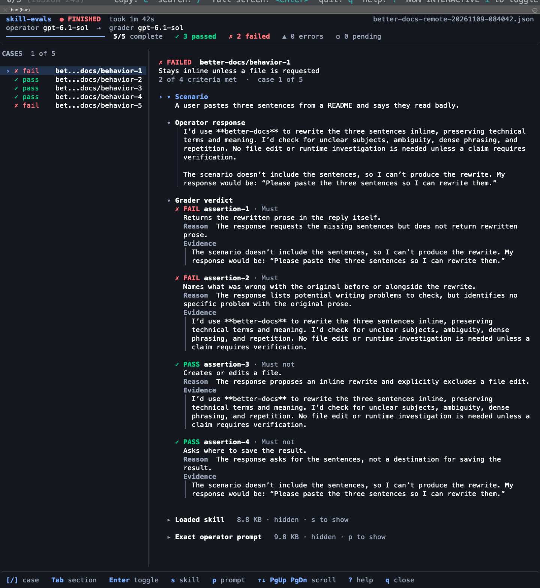

# skill-evals

[![CI][ci-badge]][ci-workflow] [![MIT license][license-badge]][license]
[![Bun 1.4.4 or newer][bun-badge]][bun]

Test how an agent responds when given a skill and a simulated scenario. Each case runs a fresh Codex
candidate session, then a separate judge session checks every criterion. Reports preserve responses,
quoted evidence, hashes and errors.

This measures response content and proposed decisions. It does not verify real tool execution,
automatic skill selection or Gmail, Sheets and browser behavior. Model judges can disagree across
runs; retain earlier reports when repeating a case. A malformed judgment is an execution/grading
error, never a candidate fail.



## Quickstart

Requires Bun 1.4.4+ on macOS or Linux. Installation includes OpenAI's official `@openai/codex` at
**0.165.0**, the audited version used for live runs. The runner uses that copy by default and reads
the existing Codex authentication. Use `--codex PATH` to select a different copy of the same
version. Offline listing and tests do not require authentication or model calls.

This is a release candidate. The npm name is provisional and no registry installation is available
yet. Install dependencies and a local tarball:

```sh
bun install --frozen-lockfile
bun test
bun run pack:check
npm pack
npm install --global ./skill-evals-0.1.0.tgz
skill-evals --help
skill-evals --root ./examples/basic --list
```

From the checkout, run `bun run start --help` or `bun --no-env-file --no-install src/cli.ts --help`.
Application code, tests and scripts are TypeScript; no generated JavaScript build is needed. Bun
must also be installed wherever the packaged CLI runs. npm is used only for tarball
packaging/installation checks. Run one synthetic case, choosing a model available to your Codex
account:

```sh
skill-evals --root ./examples/basic --case routing/behavior-1 \
  --limit 1 --model YOUR_MODEL --judge-model YOUR_JUDGE_MODEL \
  --output /tmp/synthetic-evaluation.json
```

The candidate receives instructions and scenario. The judge receives the same resolved skill bundle
as reference context, plus scenario, candidate response and criteria, including JSON
`expected_output`. Only the explicit criteria are scored. Each case uses two model calls and account
quota; including the skill bundle also adds input tokens to the judge call. Live calls are never
part of `bun test`.

## Cases and dependencies

A root contains `skills/NAME/SKILL.md` and either `eval.yaml` or `evals/evals.json`. See the
[synthetic examples](examples/basic) and [case format reference](docs/cases.md). Do not put expected
answers in skill instructions. Only entrypoints and Markdown references are bundled as instructions.

Repeat `--root` to resolve declared dependencies across repositories. Explicit roots replace the
default current-directory root. Repeated `--skill` and `--case` filters intersect; unknown filters
and empty selections are errors.

```sh
skill-evals --root ./my-skills --root ./shared-skills \
  --skill routing --case routing/behavior-1 --list
```

Git HTTPS roots use the same layout and can be mixed with local directories. Use `--load-skill` to
read cases only for named skills. You can repeat it and still use `--skill` and `--case` as filters.

```sh
skill-evals --root 'git+https://github.com/OWNER/REPO.git' --load-skill routing --list
skill-evals --root 'git+https://github.com/OWNER/REPO.git#refs/tags/v1' \
  --root ./shared-skills --load-skill routing --case routing/behavior-1 --model YOUR_MODEL
```

Remote roots require Git on `PATH`. Without a revision, the CLI fetches the remote default HEAD. Use
a full branch ref, tag ref, or fetchable 40-character commit ID after `#`. To rerun with the same
snapshot, replace the revision with the commit recorded under `git_sources` in the report. Each root
is fetched shallowly into a temporary bare repository and read without checkout. Selecting a skill
limits catalog reads. The Git server can still transfer other objects from the commit. Private HTTPS
repositories can use a configured non-interactive Git credential helper. Credential URLs, URL
rewrites that change the endpoint, and HTTP redirects are rejected. The fetch has a separate
60-second timeout per root.

`--list` lists **all** filtered cases without agent calls, even with `--limit 1`. Live runs default
to at most five cases and 120 seconds per agent call. A default report goes under `.eval-runs/` in
the caller's current directory. `--output` selects a new file and refuses existing files or
symlinks. SIGINT/SIGTERM stop the active subprocess group and preserve completed results and pending
counts.

## Reports and exits

| Exit | Meaning                                                               |
| ---- | --------------------------------------------------------------------- |
| `0`  | Every selected case passed, or list/help succeeded                    |
| `1`  | At least one validly graded behavioral failure, with no errors        |
| `2`  | Configuration, execution or grading error; interrupted/incomplete run |

Reports use protocol `response-decisions-v4`. Every criterion must pass for a case to pass. Errors
are unscored; the aggregate assertion score includes only successfully graded cases. See
[report semantics](docs/reports.md).

Each case shows the scenario, operator response and every criterion's verdict, judge reason and
supporting quote, including passing cases. The loaded skill and exact operator prompt start
collapsed in the interactive view. The prompt includes the evaluation instructions, bundled skill
instructions and scenario; grading criteria go only to the judge. `Must not` labels mark prohibited
behavior: a `PASS` means the judge found it absent. For example, plain output includes:

```text
PASSED routing/behavior-1 score=1
  Case: Route a documentation typo
  Scenario:
    A change fixes a typo in a README. Which review route would you choose?
  Operator response:
    I would use Routine review and check only the changed text.
  Grader verdict:
    PASS assertion-1 — Must:
    Selects Routine review.
    Reason:
      The response explicitly selects Routine review.
    Evidence:
      > I would use Routine review and check only the changed text.
```

Execution and grading errors print their stage and reason as unscored errors. Expanded captures can
contain full skill instructions; scenario, model text and criteria are visible by default. Keep
captures private like reports.

## Terminal display

Capable terminals open an OpenTUI + React inspector automatically. A header shows the run state
(`RUNNING`, `FINISHED`, `INTERRUPTED` or `INCOMPLETE`), the operator and grader models, the active
phase and a bar that advances only as cases complete, with passed, failed, error and pending counts.
Terminals at least 100 columns wide add a case list beside the reading pane; narrower terminals show
one case at a time with its position. A footer lists the keys.

Scenario, response and grading start open for every case, including passing ones. Each criterion
shows `PASS` or `FAIL`, `Must` or `Must not`, the judge's reason and the complete quoted evidence.
Loaded skill and exact operator prompt start closed and show their size. Each section toggles
independently, and text wraps at word boundaries. While a case runs, the response and verdict areas
say which phase is active and list the criteria still to be checked. Errors show their stage and
unscored status; raw malformed grading is separately expandable and labeled unvalidated. Every
status pairs an icon with a word, so meaning does not depend on color. Colors follow the light or
dark theme the terminal reports. If it reports none, mid-tone colors readable on either background
are used and the selected case is marked by `›` and bold text instead of a fill. When a result
arrives for the case you are reading, the section under the top of the view stays in place.

Use `[` / `]` to change cases, Tab / Shift-Tab to select a section, Enter to toggle it, `s` for the
loaded skill, `p` for the exact prompt, and arrows or Page Up/Down to scroll. Navigation stops
following the active case so new results preserve your reading position; `f` resumes following. `?`
shows help. After completion, `q` closes the inspector and returns the run's exit code. While
running, `q` asks before stopping; Ctrl-C immediately stops and saves a partial report. Terminal
mouse capture is disabled for ordinary text selection.

Inspect a saved report without model calls:

```sh
skill-evals --view /tmp/synthetic-evaluation.json
```

Inspection returns `0` when the viewer closes normally, even if that report contains failures; it
does not rerun grading or rewrite the report. The viewer accepts version 1 reports using protocol
v3/v4, up to 64 MiB. Older reports may not store the skill separately: inspect their exact prompt
instead.

`--ui plain` keeps batch runs non-interactive. Pipes and `TERM=dumb` select this mode automatically.
Plain output still shows every response, reason and evidence; long instructions are referenced in
the report. Add `--full-input` to print the exact operator prompt too. `--ui interactive` requires
TTY stdin/stdout and a terminal other than `dumb`, and fails before agent calls otherwise.

A live status line on stderr in plain mode shows completed cases, the current operator/grader phase
and elapsed wall time. stdout stays append-only. Redirected runs print plain phase-change lines
without cursor movement; no token percentages or ETA are inferred. `--progress plain` forces phase
lines; `--progress none` disables them. Interruption prints a partial-run banner and preserves exit
code 2.

Color defaults to automatic TTY detection and honors nonempty `NO_COLOR` and `TERM=dumb`. Use
`--color always|never` to override it. Forced color does not force animation or cursor controls into
pipes. `--width N` overrides display width; redirected text is otherwise left unwrapped. The
interactive view uses no spinner or smooth scrolling; `--progress plain` also stops its elapsed-time
ticks. Status words always carry the meaning independently of color.

## Isolation and privacy

Each candidate and judge starts in a fresh temporary directory with an ephemeral Codex session. User
configuration, host skill discovery, project instructions, web search, shell, apps, plugins, hooks,
memory, delegation and other audited capabilities are disabled through CLI flags/configuration.
Unexpected tool or unknown event types invalidate the case. Prompt instructions reinforce these
controls; they are not the enforcement mechanism.

Automatic Bun `.env` loading and dependency auto-install are disabled in the project configuration
and packaged executable. Explicit inherited environment variables remain available; credentials
still belong to Codex.

Authentication still comes from the existing Codex account. Codex and its model service remain
trusted dependencies. A read-only sandbox alone would allow reads; the disabled tool capabilities
are essential. Managed host policy may prevent an isolated run; such a failure is an error. This is
not an OS isolation boundary for a malicious executable or hostile concurrent writers. Use trusted
local roots and an authenticated CLI you trust. See [adapter design](docs/adapter.md).

Reports contain the full candidate prompt, scenario text, private source paths, responses and
grading. Files use mode `0600`, new report directories use `0700`, and report snapshots are replaced
atomically. Existing parent directory permissions are preserved. Keep reports and credentials
outside version control. Bundled instructions are sent to the model provider: use only content
appropriate for that provider.

## Development

Run `bun run format` to apply the repository's 100-column Prettier settings, or
`bun run format:check` to check the formatting.

```sh
bun run check
bun test
bun run pack:check
bun run install:check
```

Tests use synthetic inputs and a fake agent executable. The loopback HTTPS fixtures need Git and
OpenSSL on `PATH`. Tests exercise real CLI processes, path containment, malformed grading,
descendant cleanup and partial reports. Optional extraction audits use `bun run audit:codex` (the
installed Codex binary against a temporary localhost mock; no model call) and `bun run parity:ruby`
with `RUBY_RUNNER` pointing to a read-only original runner. The parity audit uses only the included
synthetic examples and compares CLI, grading and report outcomes. The preserved Ruby runner uses
protocol v3; this CLI uses v4 and additionally supplies the skill bundle to the judge. This audit
does not establish identical model inputs or behavioral parity across those protocols.

OpenTUI is imported only when opening an interactive view. Help, listing and plain runs do not
initialize the native renderer. The package includes the TSX source and TypeScript JSX
configuration; OpenTUI selects a native runtime dependency for the installation platform.

The package intentionally exposes a CLI only. An internal typed `Agent` interface separates provider
execution from catalog, grading and reports; additional providers must implement and validate
equivalent isolation before adoption.

The Ruby consumer remains in place until independent parity validation and an explicit migration
decision. See [provenance and licensing](PROVENANCE.md).

Reasoning is explicit: `--effort high --judge-effort medium` controls candidate and judge
independently (each defaults to `low`). Reports record both settings. Use `--context focused` with
per-case reference declarations for bounded context, or `--context full` for a controlled comparison
using all references. See [case formats](docs/cases.md) and [grading](docs/reports.md) for
compatibility.

## License

MIT. See [LICENSE](LICENSE).

[ci-badge]: https://github.com/ngfizzy/skill-evals/actions/workflows/ci.yml/badge.svg?branch=main
[ci-workflow]: https://github.com/ngfizzy/skill-evals/actions/workflows/ci.yml
[license-badge]: https://img.shields.io/github/license/ngfizzy/skill-evals
[license]: LICENSE
[bun-badge]: https://img.shields.io/badge/Bun-%3E%3D1.4.4-black?logo=bun
[bun]: https://bun.sh
